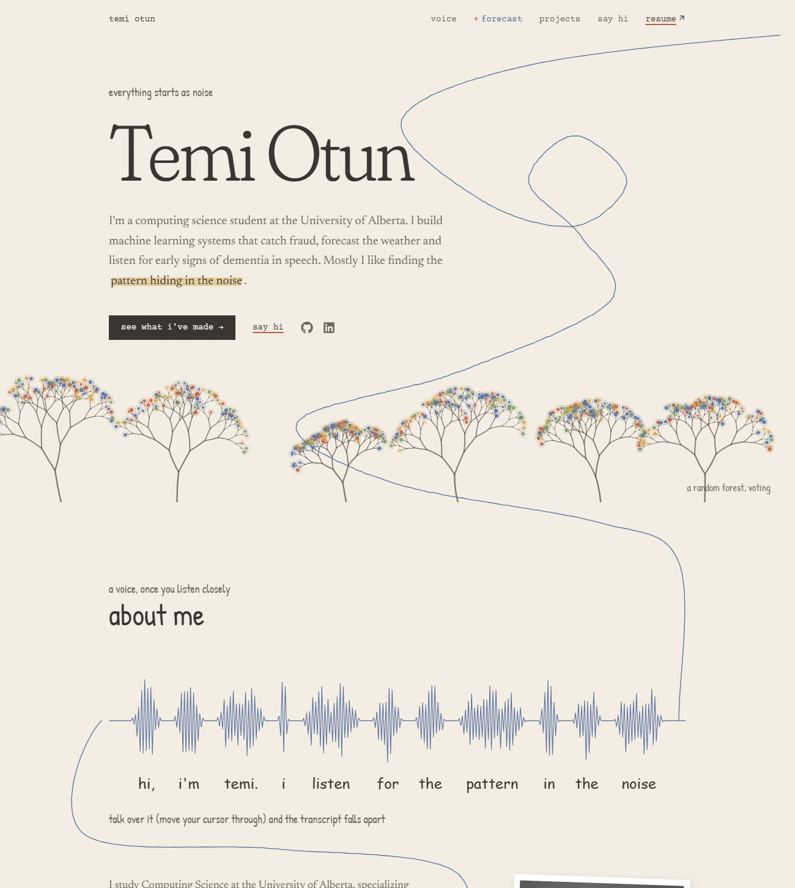

# Temi Otun · portfolio

My personal site: [temiotun.com](https://temiotun.com)



I'm a computing science student at the University of Alberta who builds machine learning and data systems. This site is meant to feel like a sketchbook rather than a template: soft pencil on warm paper, hand-lettered captions, and generative drawings that are all small ML ideas.

## The idea: one line, one idea per scene

A single hand-drawn line runs the full length of the page. It starts at the top right, loops over the name, and then turns into each chapter's artwork in turn before moving on:

| Chapter | What the line becomes | The ML idea behind it |
| --- | --- | --- |
| Hero | Loops over the name, then crosses a row of trees | **A random forest**: binary decision trees grow in, and each leaf is a coloured "vote" |
| About | A speech waveform with a handwritten transcript | **Denoising + speech-to-text**: dots start as noise, settle into one burst per word, and a playhead "listens" and writes the words. Move through it (or tap on a phone) and the transcript garbles |
| Experience | A career curve with a forecast band | **Time-series forecasting**: one point per job, then a widening uncertainty band ("wide band, open to offers"). On phones it turns vertical so time runs down the page |
| Sampler | Underlines the heading, then frames a grid | **Eight tiny models**: k-means, a linear boundary, the kernel trick, gradient descent, attention, a trend line, embeddings, dropout |
| Flock | Flies into a murmuration | **Ensembles**: boids follow three local rules, yet move as one ("many small models, one decision"). They scatter from your cursor |
| Projects | A clothesline with cards pegged on it | Each card has a small sketch of the idea behind the project |
| Night court | A basketball shot arcing into a hoop | Off the clock: travel, basketball, the gym |
| Say hi | Settles into a flat line | Beats once when a message is sent |

Every drawing is seeded, so it looks the same on every visit. Everything respects `prefers-reduced-motion`: with motion turned off, each piece is drawn in its finished state.

## How the line works

Each chapter marks where the line enters and leaves its artwork with an `<Anchor>`, and can add `<Vias>` (hand-placed waypoints) for loops and swashes. [`SignalLine.jsx`](src/art/SignalLine.jsx) measures those anchors, draws the stretches between them as a page-wide SVG with a slight pencil wobble, and inks them in as you scroll. Desktop and phone layouts have their own waypoints, so on a phone the line still goes through the sampler and around the chart without crossing text.

To reroute the line, edit the point lists in the chapter components (for example `FLOURISH` in `Hero.jsx`, `GAP` and `PHOTO` in `About.jsx`, `THREAD` in `Models.jsx`).

## Project layout

```
src/
  home.js            page composition: nav, the line, then each chapter in order
  data.js            all the content: experience, projects, skills, links
  theme.js           the pencil palette (kept in sync with the Tailwind config)
  components/        one file per chapter, plus ui/ helpers (captions, reveal, link arrow)
  art/               the generative pieces
    SignalLine.jsx     the page-long line, anchors and waypoints
    RandomForest.jsx   hero trees (canvas)
    Voice.jsx          waveform + transcript (canvas)
    Forecast.jsx       career curve, wide and tall layouts (SVG)
    Sampler.jsx        the eight-tile model sampler (SVG)
    Murmuration.jsx    boids (canvas)
    Figure.jsx         project sketches (SVG)
    random.js          seeded randomness
    useCanvas.js       sizes a canvas to its box, crisp on retina
backend/
  server.js          Express + Nodemailer endpoint for the contact form
public/
  index.html         Tailwind config, fonts, favicon
```

To change what the site says, edit [`src/data.js`](src/data.js). The components only handle layout and drawing.

## Stack

- **React 19** (Create React App)
- **Tailwind CSS**, loaded from the CDN, with the palette and fonts configured in `public/index.html`
- **Framer Motion** for reveals and line draw-ins
- **Canvas and SVG** for all the generative art, with no graphics libraries
- **Fonts**: Fraunces (name), Patrick Hand (captions), Newsreader (body), Instrument Serif (job and project titles), Courier Prime (labels)
- **Contact form**: Axios posts to a small Express + Nodemailer server deployed on Render

## Running it locally

```bash
npm install
npm start          # http://localhost:3000
npm run build      # production build in build/
```

The contact form posts to the deployed backend. To run the backend yourself:

```bash
cd backend
npm install
SMTP_USER=you@gmail.com SMTP_PASS=your-app-password node server.js   # port 5000
```

and point the URL in `src/components/Contact.jsx` at `http://localhost:5000/send-email`.

## Contact

- Email: [Otun226@gmail.com](mailto:Otun226@gmail.com)
- LinkedIn: [Temi Otun](https://www.linkedin.com/in/temi-otun-297801250/)
- GitHub: [temii70](https://github.com/temii70)

## License

[Apache 2.0](LICENSE)
